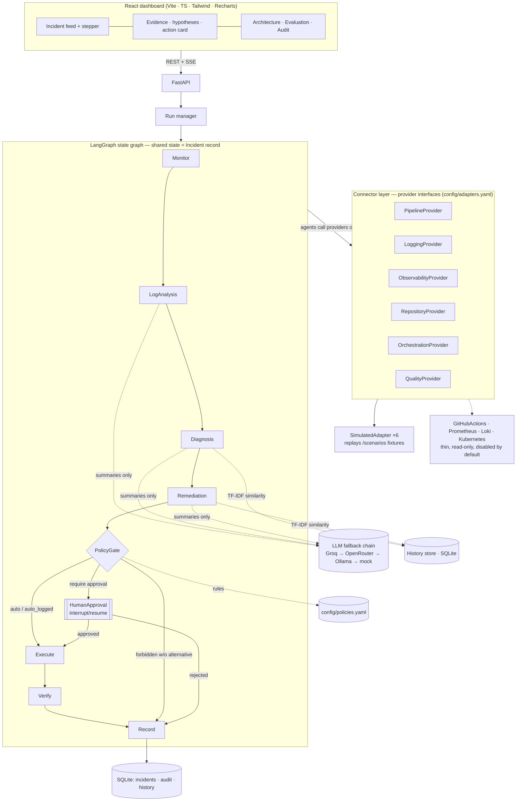

# AutoOps — an intelligent multi-agent system for autonomous DevOps

An MVP of an autonomous incident-response pipeline built from cooperating agents. On a simulated incident it runs
the whole loop — **detect → analyze logs → diagnose root cause → propose a fix → policy gate → human approval →
execute → verify → record** — through real code paths, with simulated data behind the connectors. It runs
**offline, with no cluster, in one command**.


## Quick start

```bash
cp .env.example .env        # optional: add GROQ_API_KEY / OPENROUTER_API_KEY; without keys the deterministic mock LLM is used
docker compose up --build   # → http://localhost:8000
```

Without Docker (Python 3.11 + Node 18+):

```bash
make install    # venv + backend deps + frontend deps
make dev        # API on :8000, dashboard on http://localhost:5173 (hot reload)
make test       # 55 pytest cases, MOCK_LLM forced
```

`make build` builds the dashboard into `frontend/dist`; the API then serves it on http://localhost:8000 as well.

| Setting | Default | Meaning |
|---|---|---|
| `MOCK_LLM` | `false` | `true` forces the deterministic mock LLM. With no API keys the chain falls through to the mock anyway. |
| `STEP_DELAY_S` | `1.0` | Seconds each agent step is held so the UI can animate (`0` = instant). |
| `GROQ_API_KEY`, `OPENROUTER_API_KEY`, `OLLAMA_ENABLED` | — | Enable providers of the LLM fallback chain (`config/llm.yaml`). |

## Architecture



Key boundaries (see `CLAUDE.md` for the full contract):

1. **Connector layer** — agents call only the six provider interfaces in `backend/app/connectors/base.py`.
   A `SimulatedWorld` replays a scenario and reacts to actions: the *correct* fix heals it, a wrong one doesn't,
   so verification is real. Real adapters are read-only (`allow_writes: false`) and disabled unless configured.
2. **Incident record** (`backend/app/models/incident.py`) is the graph state and the stored unit;
   its JSON Schema is exported to `schema/incident.schema.json` (a test fails if it is stale).
3. **Agents** each have typed `*Input`/`*Output` models (`backend/app/models/agents.py`):
   * **Monitor** — EWMA z-score detector on metrics + pod/deployment/pipeline health; opens the incident; re-checks after the fix.
   * **LogAnalysis** — deterministic parser masks variables and groups lines into templates (e.g. 4,487 lines → 20 patterns);
     only the top 8 groups go to the LLM; reports the log reduction ratio.
   * **Diagnosis** — scores root-cause signatures (`config/signatures.yaml`) on logs, preceding change, metrics, k8s/pipeline
     state and TF-IDF-similar past incidents; the LLM may re-rank/explain but cannot invent categories.
   * **Remediation** — proposes rerun / restart / rollback / config change / PR / scale / delete with expected effect and risk,
     choosing the action from runbooks + similar incidents. It never executes.
   * **PolicyGate** — rule-based, no LLM, first match wins, fail-safe default. Forbidden actions are blocked and replaced by
     a safer alternative that is re-evaluated.
   * **Orchestrator** — LangGraph graph with an `interrupt()` for human approval (survives restarts via rehydration);
     stops and flags the incident when data is missing.
4. **History store** — SQLite + TF-IDF over 34 synthetic incidents and 8 runbook entries, plus loader stubs for GHALogs
   (retrievable) and LogChunks / RCAEval (**test-only**, never in prompts or similarity search).

More: [`docs/architecture.md`](docs/architecture.md) · [`docs/evaluation.md`](docs/evaluation.md) · [`docs/demo-script.md`](docs/demo-script.md)

## Scenarios (Online Boutique)

| | Scenario | Env | Ground truth | Correct fix | Gate |
|---|---|---|---|---|---|
| a | `checkout-config-crashloop` | production | malformed `PAYMENT_SERVICE_ADDR` in ConfigMap → CrashLoopBackOff | config change | require approval |
| b | `cart-oom-killed` | staging | memory limit lowered to 128Mi → OOMKilled | config change (512Mi) | auto · logged |
| c | `catalog-bad-image` | production | image tag `v0.10.2-rc1` doesn't exist → ImagePullBackOff | rollback | require approval |
| d | `ci-test-regression` | ci | rounding regression → GitHub Actions `unit-tests` fails | revert PR | auto · logged |
| e | `frontend-stale-canary` | production | abandoned canary gets traffic; runbook says *delete it* | scale to 0 | **forbidden → alternative** |

Each folder holds `scenario.yaml` (ground truth + accepted fixes), `logs.txt`, `metrics.json`, `change.json`,
`k8s.json`, `pipeline.json`. Regenerate with `make fixtures`.

## 5-minute demo script

Best order: **c → e → b → d → Evaluation** (production approval first, then the safety story, then autonomy, then the numbers).

1. **(0:00) Architecture tab.** One sentence per layer: connectors (all *Simulated* here, real adapters read-only),
   the LangGraph graph, the gate, the LLM chain. Leave it open.
2. **(0:30) Replay c — bad image in production.** Click *Replay scenario → c*. Switch to *Architecture*: the active node
   moves Monitor → … → Policy Gate and stops glowing amber on **Human Approval**. Back to *Incidents*:
   * Stepper shows each agent's duration. *Evidence → Log patterns*: 4,745 lines → 19 patterns → 8 sent to the LLM (99.8% reduction).
   * Hypothesis #1 **bad image (97%)** with evidence chips — click `log:…` and `change:b71d2a9` to jump to the pattern and the diff.
   * *Metrics*: frontend p95 latency with the anomaly shaded. Action card: **rollback to revision 23**, risk medium,
     gate *Requires approval (P050)*. Type a reason, **Approve** → Execute → Verify (4/4 replicas, latency back to baseline) → Resolved.
3. **(2:00) Replay e — the forbidden action.** The runbook and a past incident say "delete the stale canary"; Remediation
   proposes `delete_resource deployment/frontend-canary` in production. The gate shows it **struck through and BLOCKED
   (P010)** and substitutes **scale to 0** (reversible), which needs approval. Approve with a reason → error rate recovers.
4. **(3:00) Replay b — autonomous in staging.** OOMKilled cartservice: diagnosis *memory limit*, fix *raise limit to 512Mi*,
   gate *automatic · logged* → executes and verifies with no human. Point at the *Audit log* entry.
5. **(3:40) Replay d — CI.** GitHub Actions unit-tests fail; diagnosis distinguishes *code regression* (assertion + src change)
   from *flaky test*; opens a revert PR automatically (PRs are auto-logged; merging stays with code review).
6. **(4:15) Evaluation tab → Run evaluation.** All 5 scenarios replay headless against ground truth: agents detect in ~24 s
   vs ~4 min for static alerts, reach the correct diagnosis in ~24 s vs ~40 min modeled manual work, top-1 100% vs 60%,
   ~99% of log lines kept out of the LLM, 1 unsafe action blocked (the baseline executes it), 3/5 human approvals.
   Stress that the baseline's manual time is a documented model while the agent numbers are measured.
7. (Optional) Scenario a, or *Reject* an approval to show nothing executes.

## What is real vs simulated

| Real (runs as-is) | Simulated |
|---|---|
| Agents, detectors, log parser, diagnosis scoring, remediation, policy gate, LangGraph orchestration with interrupt/resume, SQLite storage, audit log, TF-IDF history search, SSE, evaluation harness, UI | Data behind the providers: metrics, logs, k8s state, commits, pipelines (fixtures replayed by `SimulatedWorld`, which reacts to fixes) |
| LLM fallback chain over OpenAI-compatible APIs (Groq, OpenRouter, Ollama) | Mock LLM (deterministic) when no key is set or `MOCK_LLM=true` |
| Thin GitHub Actions / Prometheus / Loki / Kubernetes adapters (read-only, disabled by default) | Baseline's manual investigation time (documented model) |

## Known limits

* Single process; runs and approvals live in-process (interrupted runs are rehydrated from SQLite after a restart, but there is no queue/worker pool).
* Real adapters are intentionally thin and only exercised manually; tests cover the simulated path.
* Five scenarios are a demonstration, not a benchmark; the diagnosis signatures were written with these failure classes in mind.
* The baseline's manual-investigation time is modeled, not measured on engineers.
* No authentication on the API/UI (demo only); approver name is free text.

## Repository layout

```
backend/    FastAPI app, agents, connectors, orchestrator, store, evaluation, tests
frontend/   React dashboard
scenarios/  scenario fixtures + generator
schema/     incident.schema.json (exported)
config/     adapters.yaml · policies.yaml · llm.yaml · signatures.yaml · remediations.yaml
data/       history seed (synthetic incidents, runbooks, GHALogs/LogChunks/RCAEval stubs)
docs/       architecture, evaluation method, demo script
```
